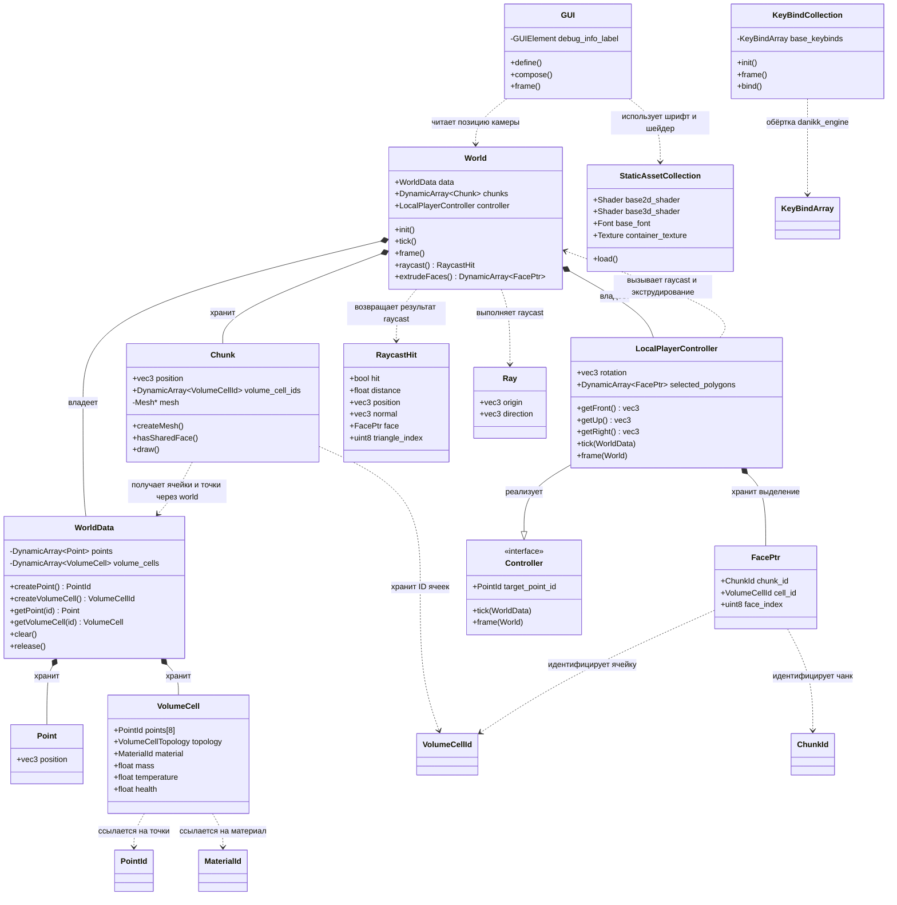

# Внутренняя архитектура проекта

Справочник описывает текущие связи классов, структур и функций проекта. Пути заголовков указаны относительно `include/danikk_space_engine`. Вложенные списки показывают поля, методы и связи типов.

## Точки входа runtime

- `main.cpp` — callback-функции движка; отдельного заголовка с их объявлениями нет.
  - `pre_begin()` — сейчас пустая функция.
  - `begin()` — задаёт заголовок окна, инициализирует привязки клавиш, загружает ассеты и материалы, настраивает GUI, регистрирует локализацию, инициализирует мир и выбирает 2D-шейдер.
  - `frame()` — обновляет GUI, проверяет привязки клавиш, выполняет тик мира и запускает отрисовку мира.

Порядок запуска и кадра:

```text
begin()
  -> key_binds.init()
  -> static_asset_collection.load()
  -> loadMaterials()
  -> gui.define() -> gui.compose()
  -> initLocaliztion()
  -> world.init()

каждый кадр
  -> gui.frame()
  -> key_binds.frame()
  -> world.tick() -> controller.tick(data)
  -> world.frame()
       -> Chunk::draw() для каждого чанка
       -> controller.frame(world)
            -> при Alt+E: World::extrudeFaces()
            -> raycast, обновление выделения, подсветка полигонов
```

## UML-схема активных подсистем



На диаграмме показан активный runtime. `shape/shape.cpp` содержит собираемый кэш мешей, который пока не вызывается при запуске. `source/shape/collision_matrix.cpp` не включён в Meson-сборку, поэтому legacy-код форм и коллизий сюда не включён.

## Мир и геометрия

## world/world.h:

- `World` — управляет состоянием мира и его кадром. Глобальный экземпляр `world` определён в `world.cpp`.
  - Поля:
    - `data` — `WorldData`, хранилище точек и `VolumeCell`.
    - `chunks` — `DynamicArray<Chunk>`, чанки, загруженные в мир.
    - `controller` — `LocalPlayerController`, камера, ввод и выделение.
  - Методы:
    - `init()` — очищает данные и чанки; создаёт точку камеры, тестовую призму и бипирамиду в одном чанке; строит меш чанка.
    - `tick()` — вызывает `controller.tick(data)`.
    - `frame()` — задаёт 3D-шейдер, матрицы вида и проекции; рисует чанки; вызывает `controller.frame(*this)`.
    - `raycast(origin, direction)` — обходит видимые треугольники ячеек и возвращает ближайшее попадание.
    - `raycastFromCamera()` — запускает raycast из точки камеры в направлении взгляда.
    - `extrudeFaces(faces, distance)` — создаёт призму для треугольной грани или гексаэдр для четырёхугольной; обновляет чанки и возвращает верхние грани новых ячеек.
- `RaycastHit` — временный результат raycast.
  - Поля:
    - `hit` — было ли попадание.
    - `distance` — расстояние до попадания.
    - `position`, `normal` — мировая позиция и нормаль попадания.
    - `face` — `FacePtr` попавшей грани.
    - `triangle_index` — индекс треугольника в топологии ячейки.
    - `points` — ID трёх точек треугольника.

## world/world_data.h:

- `WorldData` — приватно владеет массивами точек и ячеек. `PointId` и `VolumeCellId` — индексы в этих массивах.
  - Поля:
    - `points` — `DynamicArray<Point>`.
    - `volume_cells` — `DynamicArray<VolumeCell>`.
  - Методы:
    - `createPoint()` — добавляет точку по умолчанию и возвращает её `PointId`.
    - `createVolumeCell()` — добавляет ячейку по умолчанию и возвращает её `VolumeCellId`.
    - `getPoint(id)` — возвращает изменяемую или константную ссылку на точку.
    - `getVolumeCell(id)` — возвращает изменяемую или константную ссылку на ячейку.
    - `getPointCount()` — возвращает количество точек.
    - `getVolumeCellCount()` — возвращает количество ячеек.
    - `clear()` — уничтожает элементы массивов, сохраняя их ёмкость.
    - `release()` — освобождает память массивов.

## point.h:

- `Point` — хранит координату `vec3 position`.
  - Точки геометрии ячеек находятся в локальных координатах чанка и переводятся в мировые матрицей чанка.
  - Точка камеры контроллера сейчас хранится непосредственно в мировых координатах.
- `PointId` — псевдоним `uint32`, индекс в `WorldData::points`.

## world/volume_cell.h:

- `VolumeCell` — объёмная ячейка, ссылающаяся на точки по `PointId`; точками не владеет.
  - Поля:
    - `points` — до восьми `PointId`.
    - `topology` — тип топологии ячейки.
    - `material` — `MaterialId`.
    - `mass`, `temperature`, `health` — масса, температура и здоровье.
- `VolumeCellTopology` — enum поддерживаемых топологий: `none`, `tetrahedron`, `triangular_prism`, `triangular_bipyramid`, `octahedron`, `hexahedron`, `count`.
- `VolumeCellTriangle` — три локальных индекса вершин треугольника внутри `VolumeCell::points`.
- `VolumeCellTopologyDefinition` — описание топологии.
  - Поля:
    - `point_count` — количество точек.
    - `triangle_count` — количество треугольников.
    - `face_count` — количество граней.
    - `triangles` — таблица треугольников.
    - `triangle_face_indices` — индекс грани для каждого треугольника.
- `VolumeCellId` — псевдоним `uint32`, индекс в `WorldData::volume_cells`.
- `getVolumeCellTopologyDefinition(topology)` — возвращает описание топологии.
- `getVolumeCellFacePointIds(cell, face_index, point_ids)` — убирает внутренние рёбра триангулированной грани и возвращает её контур в правильном порядке.
- `volumeCellFacesSharePoints(cell_a, face_a, cell_b, face_b)` — проверяет, совпадают ли наборы ID точек двух граней.

## world/chunk.h:

- `Chunk` — группирует ID ячеек, применяет трансляцию и владеет GPU-мешем. Точки и ячейки принадлежат `WorldData`.
  - Поля:
    - `position` — позиция чанка.
    - `volume_cell_ids` — ID ячеек чанка.
    - `mesh` — приватный `Mesh*`, которым чанк владеет.
  - Методы:
    - `Chunk(Chunk&&)`, `operator=(Chunk&&)` — передают владение мешем и массивом ID при перемещении.
    - `~Chunk()` — освобождает меш.
    - `destroyMesh()` — освобождает GPU-ресурсы, вызывает деструктор `Mesh` и `free()`.
    - `createMesh()` — строит треугольный меш из ячеек, вычисляет нормали и планарные UV, пропускает внутренние грани и загружает буферы.
    - `hasSharedFace(cell_id, face_index)` — ищет совпадающую грань среди других ячеек этого чанка.
    - `createWorldMatrix()` — возвращает матрицу трансляции чанка.
    - `draw()` — привязывает материал первой ячейки, задаёт матрицу чанка и рисует меш.
- `ChunkId` — псевдоним `uint32`, индекс в `World::chunks`.

Поиск общих граней сейчас реализован вложенным перебором: `createMesh()` проверяет грани каждой ячейки, а `hasSharedFace()` просматривает остальные ячейки и их грани. Полная перестройка меша имеет квадратичную сложность по количеству ячеек. `World::extrudeFaces()` перестраивает меш изменённого чанка после операции.

## Идентификаторы граней и управление камерой

## world/face_ptr.h:

- `FacePtr` — идентификатор грани.
  - Поля:
    - `chunk_id` — `ChunkId` чанка.
    - `cell_id` — `VolumeCellId` ячейки.
    - `face_index` — индекс грани в топологии ячейки.
  - Метод:
    - `operator==(other)` — сравнивает все компоненты идентификатора.

`FacePtr` используется результатами raycast, контроллером выделения и подсветкой. ID сохраняют значение, пока соответствующие элементы не перемещаются на другие индексы. Удаления с уплотнением массивов и счётчиков поколений пока нет.

## controller.h:

- `Controller` — базовый интерфейс контроллера.
  - Поля:
    - `target_point_id` — `PointId` точки, используемой как позиция камеры.
  - Методы:
    - `tick(data)` — виртуальное обновление состояния.
    - `frame(world)` — виртуальная обработка на кадре; реализация базового класса пустая.
- `LocalPlayerController` — контроллер камеры и локального игрока, реализующий `Controller`.
  - Поля:
    - `rotation` — углы камеры.
    - `selected_polygons` — `DynamicArray<FacePtr>` выделенных граней.
  - Методы:
    - `getFront()` — вычисляет направление взгляда из рысканья и тангажа.
    - `getUp()` — вращает мировой вектор вверх вокруг направления взгляда с учётом крена.
    - `getRight()` — вычисляет направление вправо из векторов `front` и `up`.
    - `tick(data)` — поворачивает камеру мышью, обрабатывает крен Q/E и перемещение WASD с модификаторами скорости.
    - `frame(world)` — выполняет экструдирование по Alt+E, переключает грань по ЛКМ, снимает выделение при клике мимо и рисует подсветку.

Alt отключает крен на E, поэтому сочетание Alt+E используется для экструдирования.

## fwd.h:

- `World` — предварительное объявление для сокращения циклических включений.
- `GameObject` — предварительное объявление старого типа; активный код мира его не использует.

## Raycast и подсветка

## math/ray.h:

- `Ray` — начало и направление луча.
- `RayTriangleIntersection` — результат пересечения: флаг, расстояние и нормаль.
- `intersectRayTriangle(ray, a, b, c)` — использует алгоритм Мёллера — Трумбора, проверяя параллельность, барицентрические координаты и пересечение перед началом луча. Реализована в `math/ray.cpp`; не обходит мир — обход выполняет `World::raycast()`.

## polygon_highlight.h:

- `drawPolygonHighlight(world, face, highlight_mesh, color)` — находит грань по `FacePtr`, собирает её треугольники, слегка уменьшает геометрию вокруг центра, смещает её к камере и рисует заданным цветом с матрицей чанка.

## Материалы и ресурсы

## material.h:

- `MaterialDefinition` — описание материала.
  - Поля:
    - `name` — имя материала.
    - `color` — RGB-цвет в диапазоне 0..1.
    - `texture` — текстура.
  - Конструктор `MaterialDefinition(name, hexrgb_color, texture_name)` преобразует hex-цвет в RGB и создаёт текстуру, если передано её имя.
- `MaterialId` — псевдоним `uint32`, индекс в каталоге.
- `default_materials` — константные ID материалов void, sandstone и granite.
- `loadMaterials()` — один раз добавляет стандартные материалы.
- `getMaterialID(name)` — ищет материал по имени; если не находит, возвращает ID void.
- `getMaterial(id)` — возвращает материал по индексу без проверки границ.

Каталог `material_list` закрыт внутри `material.cpp`. `VolumeCell` хранит `MaterialId`. Сейчас `Chunk::draw()` использует материал первой ячейки для всего меша чанка.

## asset.h:

- `StaticAssetCollection` — глобальный набор ресурсов движка.
  - Поля:
    - `base2d_shader`, `base3d_shader` — базовые шейдеры.
    - `base_font` — основной шрифт.
    - `low_poly_sphere_mesh`, `cube_mesh` — поля мешей.
    - `border_texture`, `container_texture` — поля текстур.
  - Метод `load()` загружает базовые шейдеры, шрифт и текстуру контейнера; регистрирует шейдер и шрифт GUI по умолчанию.
- `static_asset_collection` — глобальный экземпляр `StaticAssetCollection`.

Старый код `BlockAtlas` в `asset.h/.cpp` закомментирован.

## GUI, привязки клавиш и локализация

## gui.h:

- `GUI` — глобальный отладочный GUI с одной надписью.
  - Поля:
    - `debug_info_label` — `GUIElement` для FPS и позиции камеры.
  - Методы:
    - `define()` — задаёт стиль текста, шейдер, шрифт, привязку и размеры символов.
    - `compose()` — добавляет надпись в `gui_root` движка.
    - `frame()` — форматирует FPS и координаты камеры из глобального `world`.
- `gui` — глобальный экземпляр `GUI`.

## keybind.h:

- `KeyBindCollection` — обёртка над движковым `KeyBindArray`.
  - Поле `base_keybinds` — массив привязок движка.
  - `init()` — привязывает Escape к выходу из приложения.
  - `frame()` — проверяет срабатывание привязок.
  - `bind(keys, event)` — передаёт привязку без аргумента в `KeyBindArray`.
  - `bind(keys, event, arg_ptr)` — передаёт привязку с указателем аргумента.
- `key_binds` — глобальный экземпляр `KeyBindCollection`.
- `closeGame()` — callback в `keybind.cpp`, не объявлен в заголовке; вызывает `danikk_engine::exit()` и используется привязкой Escape.

Alt+E и Q/E опрашиваются непосредственно в `LocalPlayerController`, а не через `KeyBindCollection`.

## localization.h:

- `localization` — глобальный экземпляр framework-класса `Localization`.
- `initLocaliztion()` — регистрирует подписи блоков на английском и русском; реализация находится в `localization.cpp`. Текущее написание функции содержит опечатку.

## Формы и коллизии (заготовки)

## shape/shape.h:

- `CollisionInfo` — результат коллизии.
  - Поля: `collided` — флаг столкновения; `normal` — нормаль контакта; `penetration` — глубина проникновения.
- `ShapeId` — псевдоним `uint32`.
- `ShapeType` — статические константы `none`, `cube`, `sphere` и `count`.
- `ShapeMesh` — пара размера формы и указателя на `Mesh`.
  - Поля: `size` — размер формы; `mesh` — указатель на меш.
- `ShapeDefinition` — описание формы и кэш мешей.
  - Поля:
    - `id`, `name` — идентификатор и имя формы.
    - `createMesh` — указатель на фабрику мешей по размеру.
    - `meshes` — `DynamicArray<ShapeMesh>` кэшированных мешей.
  - Метод `getMeshEntry(size)` ищет точный размер в кэше; при отсутствии вызывает фабрику и добавляет меш.
- `initShapeTable()` — инициализирует таблицу форм; сейчас содержит только cube и резервирует место под кэш.
- `findShape(id)` — линейно ищет форму в статической таблице.
- `clearShapeMeshCache()` — освобождает GPU-ресурсы и память кэшированных мешей.

`addQuad()` и `createCubeMesh()` определены только в `source/shape/shape.cpp`, в заголовке не объявлены. Первая добавляет сторону куба в динамический меш; вторая строит единичный куб с UV-тайлингом по размеру.

Таблица форм содержит только cube. В `main.cpp` нет вызовов `initShapeTable()` и `clearShapeMeshCache()`, поэтому кэш сейчас не подключён к старту приложения.

## shape/collision_matrix.h:

- `CollisionFunction` — указатель на функцию, принимающую два `GameObject` и возвращающую `CollisionInfo`.
- `collision_matrix` — матрица функций проверки столкновений между типами форм.

`source/shape/collision_matrix.cpp` не включён в `source/shape/meson.build` и ссылается на старый `object/gameobject.h`. Код не входит в runtime и считается отключённой заготовкой. В `.cpp` определены внутренние функции:

- `makeUnitBox()` — получает центр, оси и полуразмеры ориентированного параллелепипеда из матрицы объекта.
- `getSphereCenter()` — получает центр сферы из матрицы объекта.
- `getSphereRadius()` — вычисляет радиус сферы с учётом масштаба.
- `checkCubeCubeCollision()` — проверяет ориентированные параллелепипеды теоремой о разделяющей оси.
- `checkSphereSphereCollision()` — проверяет пересечение сфер по расстоянию между центрами.
- `checkCubeSphereCollision()` — находит ближайшую точку параллелепипеда к центру сферы и проверяет пересечение.
- `checkSphereCubeCollision()` — вызывает проверку cube-sphere с обратным порядком объектов и инвертирует нормаль.
- `checkNoCollision()` — возвращает пустой `CollisionInfo`.

## Общие соглашения и зависимости

## default.h:

- Повторно экспортирует типы и пространства имён `danikk_engine` и `danikk_framework` в `danikk_space_engine`.
- Определяет макрос `swap`.

`meson.build` подключает подпроект `danikk_engine`, который предоставляет рендеринг, ввод, GUI root, шейдеры, текстуры, шрифты и жизненный цикл окна. `DynamicArray` и базовые контейнеры предоставляет `danikk_framework`.

ID — 32-битные индексы массивов без поколений. `Chunk` вручную освобождает GPU-меш через `free()`, вызов деструктора и `free` памяти; динамические массивы предоставлены framework.
