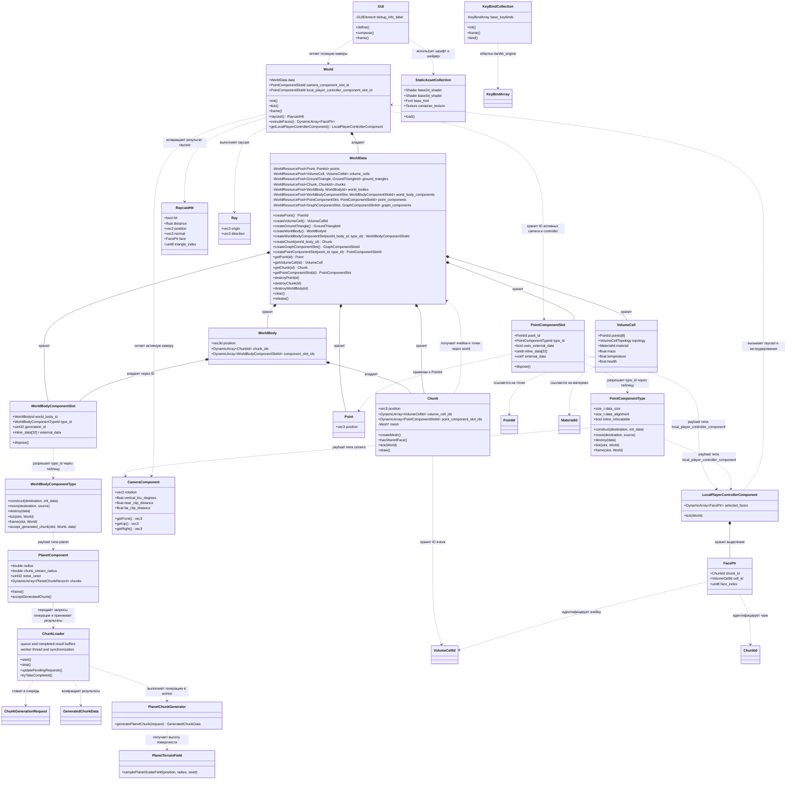

# Внутренняя архитектура проекта

Справочник описывает текущие связи классов, структур и функций проекта. Пути заголовков указаны относительно `include/danikk_space_engine`. Вложенные списки показывают поля, методы и связи типов.

## Точки входа runtime

- `main.cpp` — callback-функции движка; отдельного заголовка с их объявлениями нет.
  - `pre_begin()` — сейчас пустая функция.
  - `begin()` — задаёт заголовок окна, инициализирует привязки клавиш, загружает ассеты и материалы, настраивает GUI, регистрирует локализацию, инициализирует мир и выбирает 2D-шейдер.
  - `frame()` — обновляет GUI, проверяет привязки клавиш, выполняет тик мира и запускает отрисовку мира.

Порядок запуска и кадра:

```text
begin()
  -> key_binds.init()
  -> static_asset_collection.load()
  -> loadMaterials()
  -> gui.define() -> gui.compose()
  -> initLocaliztion()
  -> world.init()

каждый кадр
  -> gui.frame()
  -> key_binds.frame()
  -> world.tick() -> Chunk::tick() -> PointComponentType::tick() -> LocalPlayerControllerComponent::tick()
  -> world.frame()
       -> WorldBodyComponentType::frame() для компонентов WorldBody
       -> Chunk::frame() для чанков из WorldData
       -> Chunk::draw() для чанков из WorldData
       -> drawPolygonHighlights(world): raycast наведённой грани и подсветка
```

## UML-схема активных подсистем



На диаграмме показан активный runtime. `shape/shape.cpp` содержит собираемый кэш мешей, который пока не вызывается при запуске. `source/shape/collision_matrix.cpp` не включён в Meson-сборку, поэтому legacy-код форм и коллизий сюда не включён.

## Мир и геометрия

## world/world.h:

- `World` — управляет состоянием мира и его кадром. Глобальный экземпляр `world` определён в `world.cpp`.
  - Поля:
    - `data` — `WorldData`, хранилище сущностей мира, геометрии и компонентов.
    - `camera_component_slot_id` — ID активного компонента камеры.
    - `local_player_controller_component_slot_id` — ID компонента локального контроллера.
  - Методы:
    - `init()` — очищает данные, запускает `ChunkLoader` и базовый сценарий с камерой и планетой.
    - `tick()` — обновляет компоненты точек и компонентов `WorldBody`.
    - `frame()` — вызывает frame-компоненты `WorldBody`, передаёт генератору запросы, принимает готовые чанки; затем настраивает камеру, рисует чанки и вызывает `drawPolygonHighlights(*this)`.
    - `raycast(origin, direction)` — обходит видимые треугольники ячеек и возвращает ближайшее попадание.
    - `raycastFromCamera()` — запускает raycast из точки камеры в направлении взгляда.
    - `extrudeFaces(faces, distance)` — создаёт призму для треугольной грани или гексаэдр для четырёхугольной; обновляет чанки и возвращает верхние грани новых ячеек.

## world/body.h:

- `WorldBody` — владеет списком чанков и ID своих компонентов; служит системой координат для планет и подвижных тел.
  - `position` — мировая позиция тела.
  - `chunk_ids` — чанки геометрии, принадлежащие телу.
  - `component_slot_ids` — компоненты, чьи payload находятся в пуле `WorldData`.

## component/world_body/world_body.h:

- `WorldBodyComponentTypeId` — ID типа компонента WorldBody; сейчас содержит `none` и `planet`.
- `WorldBodyComponentType` — таблица функций жизненного цикла и обновления типа компонента.
  - `construct`, `move`, `destroy` — управляют payload.
  - `tick`, `frame` — обновляют состояние и отрисовку компонента.
  - `accept_generated_chunk` — передаёт компоненту результат фоновой генерации.
- `WorldBodyComponentSlot` — экземпляр компонента, связанный с `WorldBodyId`.
  - Хранит ID тела, типа, поколения слота и inline либо внешний payload.
  - `dispose()` сбрасывает слот после уничтожения компонента.
- `getWorldBodyComponentType(type_id)` — возвращает запись типа из таблицы в `world_body.cpp`.

## component/world_body/planet.h:

- `PlanetComponentSettings` — начальные параметры планеты: радиус, радиус стриминга и seed шума.
- `PlanetComponent` — состояние процедурной планеты и стриминга её чанков.
  - Хранит параметры генерации, направление последнего обновления, требуемые ключи чанков, очередь запросов и записи загруженных чанков.
  - `framePlanetComponent(slot, world)` — вычисляет направление камеры относительно тела; при выходе из диапазона выгружает чанки, а при смещении камеры пересобирает набор нужных ключей и ставит отсутствующие чанки в очередь `ChunkLoader`.
  - `acceptPlanetGeneratedChunk(slot, world, generated_chunk)` — проверяет актуальность ключа, создаёт чанк и его точки/треугольники из результата фоновой генерации, затем регистрирует чанк в компоненте.

## world/planet/terrain.h:

- `samplePlanetScalarField(position, radius, noise_seed)` — возвращает скалярное поле планеты: положительное значение внутри, ноль на поверхности и отрицательное снаружи. Шум задаёт рельеф.

## world/planet/chunk_generator.h:

- `ChunkGenerationRequest` — снимок параметров одного чанка поверхности для фонового потока; содержит ориентацию участка, координаты сетки, радиус и seed.
- `GeneratedChunkData` — результат фоновой генерации: локальные координаты вершин и индексы треугольников, а также идентификаторы владельца и запроса.
- `generatePlanetChunk(request)` — строит сетку участка кубической сферы, деформирует вершины скалярным полем и возвращает локальную геометрию.

## world/chunk_loader.h:

- `ChunkLoader` — управляет worker-потоком, очередью запросов и завершёнными результатами; генерация геометрии вынесена в `generatePlanetChunk()`.
  - `start()` / `stop()` — запускают и останавливают поток.
  - `updatePendingRequests(generation_id, requests)` — заменяет список актуальных запросов и убирает дубликаты уже выполняемых или завершённых задач.
  - `tryTakeCompleted(result)` — выдаёт готовый результат текущего поколения.
- `RaycastHit` — временный результат raycast.
  - Поля:
    - `hit` — было ли попадание.
    - `distance` — расстояние до попадания.
    - `position`, `normal` — мировая позиция и нормаль попадания.
    - `face` — `FacePtr` попавшей грани.
    - `triangle_index` — индекс треугольника в топологии ячейки.
    - `points` — ID трёх точек треугольника.

## world/data.h:

- `WorldData` — приватно владеет восемью `WorldResourcePool`, по одному для каждого типа ресурса. ID адресуют слоты пула; освобождённые ID могут использоваться повторно.
  - Поля:
    - `points` — `WorldResourcePool<Point, PointId>`.
    - `volume_cells` — `WorldResourcePool<VolumeCell, VolumeCellId>`.
    - `ground_triangles` — `WorldResourcePool<GroundTriangle, GroundTriangleId>`.
    - `chunks` — `WorldResourcePool<Chunk, ChunkId>`.
    - `world_bodies` — `WorldResourcePool<WorldBody, WorldBodyId>`.
    - `world_body_components` — `WorldResourcePool<WorldBodyComponentSlot, WorldBodyComponentSlotId>`.
    - `point_components` — `WorldResourcePool<PointComponentSlot, PointComponentSlotId>`.
    - `graph_components` — `WorldResourcePool<GraphComponentSlot, GraphComponentSlotId>`.
  - Методы:
    - Создание:
      - `createPoint()`, `createVolumeCell()`, `createGroundTriangle()`, `createWorldBody()` — выделяют ресурс и возвращают его ID.
      - `createWorldBodyComponentSlot(world_body_id, type_id, init_data)` — создаёт слот, размещает payload, вызывает конструктор типа и регистрирует ID в соответствующем `WorldBody`.
      - `createChunk(world_body_id)` — создаёт чанк, записывает его владельца и регистрирует чанк в `WorldBody`; возвращает ссылку на чанк.
      - `createPointComponentSlot(point_id, type_id, init_data)` — проверяет точку и описание типа, выделяет слот, размещает payload внутри слота или отдельно, вызывает конструктор компонента и возвращает ID.
      - `createGraphComponentSlot(chunk_id, point_a, point_b, type_id, init_data)` — создаёт компонент связи между двумя точками, выделяет payload и добавляет слот в чанк.
    - Привязка к чанкам:
      - `addPointReferenceToChunk(chunk_id, point_id)` — добавляет уникальную для чанка ссылку на точку и увеличивает `chunk_reference_count`; при превышении 100 вызывает критическую ошибку.
      - `addVolumeCellToChunk(chunk_id, cell_id)` — добавляет ячейку, регистрирует её точки в чанке и инвалидирует меш.
      - `addGroundTriangleToChunk(chunk_id, triangle_id)` — добавляет треугольник и ссылки на его точки, затем инвалидирует меш.
      - `addPointComponentSlotToChunk(chunk_id, slot_id)` — регистрирует слот в чанке, добавляет ссылку на его точку и записывает `chunk_id` в слот.
    - Удаление:
      - `destroyPoint(id)` — удаляет точку из списков чанков, уничтожает связанные с ней point/graph компоненты, ячейки и треугольники, затем освобождает точку.
      - `destroyVolumeCell(id)` и `destroyGroundTriangle(id)` — удаляют ресурс из чанков, инвалидируют их меши и освобождают ID.
      - `destroyChunk(id)` — удаляет чанк из `WorldBody`, уничтожает его компоненты, ячейки и треугольники, освобождает ссылки на точки и уничтожает точки, у которых не осталось чанков-владельцев.
      - `destroyWorldBody(id)` — уничтожает компоненты и чанки тела, затем освобождает само тело.
      - `destroyPointComponentSlot(id)`, `destroyGraphComponentSlot(id)` и `destroyWorldBodyComponentSlot(id)` — отсоединяют компонент от владельца, уничтожают payload, вызывают `dispose()` слота и освобождают ID.
    - Запросы и доступ:
      - `isPointActive(id)` и соответствующие `is...Active(id)` для остальных семи ресурсов — проверяют, активен ли ID.
      - `getUsedPointIds()` и соответствующие `getUsed...Ids()` — возвращают массив ID активных ресурсов для итерации.
      - `getPoint(id)`, `getVolumeCell(id)`, `getGroundTriangle(id)`, `getChunk(id)`, `getWorldBody(id)`, `getPointComponentSlot(id)`, `getGraphComponentSlot(id)` — возвращают изменяемую или константную ссылку; неактивный ID вызывает критическую ошибку.
      - Восемь методов `get...Count()` — возвращают размер слотового массива пула, включая свободные слоты; это не число активных ресурсов.
    - Очистка:
      - `clear()` — уничтожает компоненты, очищает все пулы и сохраняет их выделенную ёмкость.
      - `release()` — вызывает `clear()` и освобождает ёмкость всех пулов.

## world/point.h:

- `Point` — хранит координату `vec3 position`.
  - Точки геометрии ячеек находятся в локальных координатах чанка и переводятся в мировые матрицей чанка.
  - Точка камеры хранится непосредственно в мировых координатах и задаётся `PointComponentSlot::point_id`.
- `PointId` — псевдоним `uint32`, индекс в `WorldData::points`.

## component/point.h:

- `PointComponentTypeId` — enum ID типа компонента точки: `none`, `camera`, `local_player_controller_component`, `machine_gun`, `engine`, `count`.
- `PointComponentType` — описание типа и таблица его операций.
  - Поля:
    - `data_size`, `data_alignment` — размер и выравнивание payload.
    - `inline_relocatable` — гарантирует безопасное побайтовое перемещение payload при хранении inline.
    - `construct`, `move`, `destroy` — указатели на функции жизненного цикла payload.
    - `tick`, `frame` — указатели на функции обновления и отрисовки.
- `getPointComponentType(type_id)` — возвращает описание из таблицы в `source/component/point.cpp`; неизвестный ID возвращает запись `none`.
- `PointComponentSlot` — экземпляр компонента, привязанный к `PointId`.
  - Поля:
    - `type_id` — индекс типа в таблице описаний.
    - `inline_data` — встроенное хранилище до 32 байт для inline-перемещаемых типов.
    - `external_data` — указатель на внешнее хранилище для большего payload.
    - `uses_external_data` — указывает, какое хранилище используется.
  - `dispose()` — возвращает поля слота и хранилище данных к исходному состоянию после уничтожения payload.

`WorldData` владеет массивом `PointComponentSlot`. Типы `camera` и `local_player_controller_component` зарегистрированы; `machine_gun` и `engine` пока имеют пустые записи. Payload контроллера хранится снаружи, поскольку содержит `DynamicArray`.

## component/graph/graph.h:

- `GraphComponentSlot` — хранит тип graph-компонента, ID двух связанных точек и inline либо внешний payload.
  - `dispose()` — возвращает слот к исходному состоянию после уничтожения payload.

## component/camera.h:

- `CameraComponent` — состояние и параметры камеры. Позиция определяется точкой из `PointComponentSlot`; вращение хранится в компоненте.
  - Поля:
    - `rotation` — углы рысканья, тангажа и крена.
    - `vertical_fov_degrees` — вертикальный угол обзора в градусах.
    - `near_clip_distance`, `far_clip_distance` — ближняя и дальняя плоскости отсечения.
  - Методы:
    - `getFront()`, `getUp()`, `getRight()` — вычисляют базис камеры с учётом крена.
- Callback-функции компонента зарегистрированы в таблице `PointComponentType`.
- `constructCameraComponent()` — создаёт параметры по умолчанию либо копирует их из `init_data`.
- `moveCameraComponent()` и `destroyCameraComponent()` — перемещают и уничтожают payload.
- `tickCameraComponent()` — обрабатывает мышь, WASD, Q/E и модификаторы скорости; Alt приостанавливает движение и вращение.
- `frameCameraComponent()` — проверяет параметры и задаёт матрицу проекции.
- `World::init()` создаёт камеру на отдельной точке и регистрирует слот в чанке.

## world/volume_cell.h:

- `VolumeCell` — объёмная ячейка, ссылающаяся на точки по `PointId`; точками не владеет.
  - Поля:
    - `points` — до восьми `PointId`.
    - `topology` — тип топологии ячейки.
    - `material` — `MaterialId`.
    - `mass`, `temperature`, `health` — масса, температура и здоровье.
- `VolumeCellTopology` — enum поддерживаемых топологий: `none`, `tetrahedron`, `triangular_prism`, `triangular_bipyramid`, `octahedron`, `hexahedron`, `count`.
- `VolumeCellTriangle` — три локальных индекса вершин треугольника внутри `VolumeCell::points`.
- `VolumeCellTopologyDefinition` — описание топологии.
  - Поля:
    - `point_count` — количество точек.
    - `triangle_count` — количество треугольников.
    - `face_count` — количество граней.
    - `triangles` — таблица треугольников.
    - `triangle_face_indices` — индекс грани для каждого треугольника.
- `VolumeCellId` — псевдоним `uint32`, индекс в `WorldData::volume_cells`.
- `getVolumeCellTopologyDefinition(topology)` — возвращает описание топологии.
- `getVolumeCellFacePointIds(cell, face_index, point_ids)` — убирает внутренние рёбра триангулированной грани и возвращает её контур в правильном порядке.
- `volumeCellFacesSharePoints(cell_a, face_a, cell_b, face_b)` — проверяет, совпадают ли наборы ID точек двух граней.

## world/chunk.h:

- `Chunk` — группирует ID ячеек, применяет трансляцию и владеет GPU-мешем. Точки и ячейки принадлежат `WorldData`.
  - Поля:
    - `position` — позиция чанка.
    - `volume_cell_ids` — ID ячеек чанка.
    - `point_component_slot_ids` — ID слотов компонентов, обновляемых этим чанком.
    - `mesh` — приватный `Mesh*`, которым чанк владеет.
  - Методы:
    - `Chunk(Chunk&&)`, `operator=(Chunk&&)` — передают владение мешем и массивом ID при перемещении.
    - `~Chunk()` — освобождает меш.
    - `destroyMesh()` — освобождает GPU-ресурсы, вызывает деструктор `Mesh` и `free()`.
    - `createMesh()` — строит треугольный меш из ячеек, вычисляет нормали и планарные UV, пропускает внутренние грани и загружает буферы.
    - `addPointComponentSlot(id)` — регистрирует слот компонента для обновления этим чанком.
    - `tick(world)` — для каждого зарегистрированного слота вызывает `tick` из `PointComponentType`.
    - `hasSharedFace(cell_id, face_index)` — ищет совпадающую грань среди других ячеек этого чанка.
    - `createWorldMatrix()` — возвращает матрицу трансляции чанка.
    - `draw()` — привязывает материал первой ячейки, задаёт матрицу чанка и рисует меш.
- `ChunkId` — псевдоним `uint32`, индекс в `WorldData::chunks`.

При построении меша `createMesh()` сортирует канонические ключи граней по ID точек и выявляет совпадения за O(F log F), где F — число граней. `World::extrudeFaces()` перестраивает меш изменённого чанка после операции.

## Идентификаторы граней и управление камерой

## world/face_ptr.h:

- `FacePtr` — идентификатор грани.
  - Поля:
    - `chunk_id` — `ChunkId` чанка.
    - `cell_id` — `VolumeCellId` ячейки.
    - `face_index` — индекс грани в топологии ячейки.
  - Метод:
    - `operator==(other)` — сравнивает все компоненты идентификатора.

`FacePtr` используется результатами raycast, контроллером выделения и подсветкой. ID сохраняют значение, пока соответствующие элементы не перемещаются на другие индексы. Удаления с уплотнением массивов и счётчиков поколений пока нет.

## component/local_player_controller.h:

- `LocalPlayerControllerComponent` — обрабатывает выделение и редактирование полигонов.
  - Поля:
    - `selected_faces` — `DynamicArray<FacePtr>`: сначала закреплённые выделения, затем грань под курсором, если она не выделена.
    - `selected_face_count` — число закреплённых выделений в начале массива; оставшийся элемент, если есть, является наведённой гранью.
  - Методы:
    - `tick(world)` — Alt+E экструдирует и Alt+D удаляет закреплённые грани; если выделений нет, действия применяются к грани под курсором. Экструдирование наведённой грани не создаёт закреплённого выделения. ЛКМ переключает выделение и снимает его при клике мимо.
- `constructLocalPlayerControllerComponent()`, `moveLocalPlayerControllerComponent()`, `destroyLocalPlayerControllerComponent()`, `tickLocalPlayerControllerComponent()` — callbacks типа `local_player_controller_component`, реализованы в `source/component/local_player_controller.cpp`.
- `World::getLocalPlayerControllerComponent()` — возвращает payload компонента по активному slot ID.

## effects/polygon_highlight.h:

- `drawPolygonHighlight(world, face, mesh, color)` — рисует одну подсвеченную грань.
- `drawPolygonHighlights(world)` — рисует выбранные и наведённую грани из `LocalPlayerControllerComponent::selected_faces`; вызывается из `World::frame()`.

Зажатие Alt отключает ввод камеры, поэтому Alt+E и Alt+D доступны контроллеру редактирования.

## fwd.h:

- `World` — предварительное объявление для сокращения циклических включений.
- `GameObject` — предварительное объявление старого типа; активный код мира его не использует.

## Raycast и подсветка

## math/ray.h:

- `Ray` — начало и направление луча.
- `RayTriangleIntersection` — результат пересечения: флаг, расстояние и нормаль.
- `intersectRayTriangle(ray, a, b, c)` — использует алгоритм Мёллера — Трумбора, проверяя параллельность, барицентрические координаты и пересечение перед началом луча. Реализована в `math/ray.cpp`; не обходит мир — обход выполняет `World::raycast()`.

## effects/polygon_highlight.h:

- `drawPolygonHighlight(world, face, highlight_mesh, color)` — находит грань по `FacePtr`, собирает её треугольники, слегка уменьшает геометрию вокруг центра, смещает её к камере и рисует заданным цветом с матрицей чанка.

## Материалы и ресурсы

## material.h:

- `MaterialDefinition` — описание материала.
  - Поля:
    - `name` — имя материала.
    - `color` — RGB-цвет в диапазоне 0..1.
    - `texture` — текстура.
  - Конструктор `MaterialDefinition(name, hexrgb_color, texture_name)` преобразует hex-цвет в RGB и создаёт текстуру, если передано её имя.
- `MaterialId` — псевдоним `uint32`, индекс в каталоге.
- `default_materials` — константные ID материалов void, sandstone и granite.
- `loadMaterials()` — один раз добавляет стандартные материалы.
- `getMaterialID(name)` — ищет материал по имени; если не находит, возвращает ID void.
- `getMaterial(id)` — возвращает материал по индексу без проверки границ.

Каталог `material_list` закрыт внутри `material.cpp`. `VolumeCell` хранит `MaterialId`. Сейчас `Chunk::draw()` использует материал первой ячейки для всего меша чанка.

## asset.h:

- `StaticAssetCollection` — глобальный набор ресурсов движка.
  - Поля:
    - `base2d_shader`, `base3d_shader` — базовые шейдеры.
    - `base_font` — основной шрифт.
    - `low_poly_sphere_mesh`, `cube_mesh` — поля мешей.
    - `border_texture`, `container_texture` — поля текстур.
  - Метод `load()` загружает базовые шейдеры, шрифт и текстуру контейнера; регистрирует шейдер и шрифт GUI по умолчанию.
- `static_asset_collection` — глобальный экземпляр `StaticAssetCollection`.

Старый код `BlockAtlas` в `asset.h/.cpp` закомментирован.

## GUI, привязки клавиш и локализация

## gui.h:

- `GUI` — глобальный отладочный GUI с одной надписью.
  - Поля:
    - `debug_info_label` — `GUIElement` для FPS и позиции камеры.
  - Методы:
    - `define()` — задаёт стиль текста, шейдер, шрифт, привязку и размеры символов.
    - `compose()` — добавляет надпись в `gui_root` движка.
    - `frame()` — форматирует FPS и координаты камеры из глобального `world`.
- `gui` — глобальный экземпляр `GUI`.

## keybind.h:

- `KeyBindCollection` — обёртка над движковым `KeyBindArray`.
  - Поле `base_keybinds` — массив привязок движка.
  - `init()` — привязывает Escape к выходу из приложения.
  - `frame()` — проверяет срабатывание привязок.
  - `bind(keys, event)` — передаёт привязку без аргумента в `KeyBindArray`.
  - `bind(keys, event, arg_ptr)` — передаёт привязку с указателем аргумента.
- `key_binds` — глобальный экземпляр `KeyBindCollection`.
- `closeGame()` — callback в `keybind.cpp`, не объявлен в заголовке; вызывает `danikk_engine::exit()` и используется привязкой Escape.

Alt+E, Alt+D и ЛКМ опрашиваются в `LocalPlayerControllerComponent::tick()`; Q/E, WASD и мышь обрабатываются `CameraComponent::tick()`.

## localization.h:

- `localization` — глобальный экземпляр framework-класса `Localization`.
- `initLocaliztion()` — регистрирует подписи блоков на английском и русском; реализация находится в `localization.cpp`. Текущее написание функции содержит опечатку.

## Формы и коллизии (заготовки)

## shape/shape.h:

- `CollisionInfo` — результат коллизии.
  - Поля: `collided` — флаг столкновения; `normal` — нормаль контакта; `penetration` — глубина проникновения.
- `ShapeId` — псевдоним `uint32`.
- `ShapeType` — статические константы `none`, `cube`, `sphere` и `count`.
- `ShapeMesh` — пара размера формы и указателя на `Mesh`.
  - Поля: `size` — размер формы; `mesh` — указатель на меш.
- `ShapeDefinition` — описание формы и кэш мешей.
  - Поля:
    - `id`, `name` — идентификатор и имя формы.
    - `createMesh` — указатель на фабрику мешей по размеру.
    - `meshes` — `DynamicArray<ShapeMesh>` кэшированных мешей.
  - Метод `getMeshEntry(size)` ищет точный размер в кэше; при отсутствии вызывает фабрику и добавляет меш.
- `initShapeTable()` — инициализирует таблицу форм; сейчас содержит только cube и резервирует место под кэш.
- `findShape(id)` — линейно ищет форму в статической таблице.
- `clearShapeMeshCache()` — освобождает GPU-ресурсы и память кэшированных мешей.

`addQuad()` и `createCubeMesh()` определены только в `source/shape/shape.cpp`, в заголовке не объявлены. Первая добавляет сторону куба в динамический меш; вторая строит единичный куб с UV-тайлингом по размеру.

Таблица форм содержит только cube. В `main.cpp` нет вызовов `initShapeTable()` и `clearShapeMeshCache()`, поэтому кэш сейчас не подключён к старту приложения.

## shape/collision_matrix.h:

- `CollisionFunction` — указатель на функцию, принимающую два `GameObject` и возвращающую `CollisionInfo`.
- `collision_matrix` — матрица функций проверки столкновений между типами форм.

`source/shape/collision_matrix.cpp` не включён в `source/shape/meson.build` и ссылается на старый `object/gameobject.h`. Код не входит в runtime и считается отключённой заготовкой. В `.cpp` определены внутренние функции:

- `makeUnitBox()` — получает центр, оси и полуразмеры ориентированного параллелепипеда из матрицы объекта.
- `getSphereCenter()` — получает центр сферы из матрицы объекта.
- `getSphereRadius()` — вычисляет радиус сферы с учётом масштаба.
- `checkCubeCubeCollision()` — проверяет ориентированные параллелепипеды теоремой о разделяющей оси.
- `checkSphereSphereCollision()` — проверяет пересечение сфер по расстоянию между центрами.
- `checkCubeSphereCollision()` — находит ближайшую точку параллелепипеда к центру сферы и проверяет пересечение.
- `checkSphereCubeCollision()` — вызывает проверку cube-sphere с обратным порядком объектов и инвертирует нормаль.
- `checkNoCollision()` — возвращает пустой `CollisionInfo`.

## Общие соглашения и зависимости

## default.h:

- Повторно экспортирует типы и пространства имён `danikk_engine` и `danikk_framework` в `danikk_space_engine`.
- Определяет макрос `swap`.

`meson.build` подключает подпроект `danikk_engine`, который предоставляет рендеринг, ввод, GUI root, шейдеры, текстуры, шрифты и жизненный цикл окна. `DynamicArray` и базовые контейнеры предоставляет `danikk_framework`.

ID — 32-битные индексы массивов без поколений. `Chunk` вручную освобождает GPU-меш через `free()`, вызов деструктора и `free` памяти; динамические массивы предоставлены framework.
